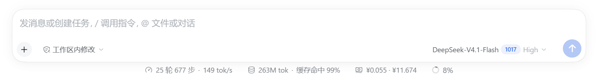
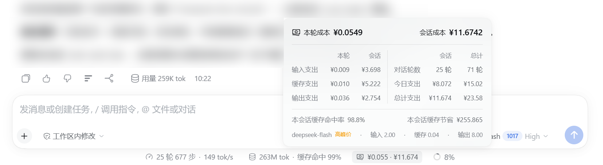

# dsh-cost-bar

> **DeepSeek Harness 插件**：在输入框信息栏显示本轮与会话的估算花费，点开可看按计费项拆分的明细，以及本会话与全部会话的对比。
>
> A composer-bar cost pill for DeepSeek Harness: this turn's and this session's estimated spend, with a two-column breakdown dialog.

<p align="center">
  
</p>

## 截图

信息栏中的成本条，位于 token 用量右侧：



点开后的明细：



## 显示内容

信息栏的金额标记显示两个数字：本轮成本 · 会话成本，各保留 3 位小数。

点开弹层：

- 表头：本轮成本、会话成本，保留 4 位小数。
- 左表按计费项拆账：输入支出、缓存支出、输出支出，各给出本轮与会话两列。
- 右表对比本会话与全部会话：对话轮数、今日支出、总计支出。总计覆盖本机所有会话，含子代理会话与从持久化日志回填的历史会话。
- 底注：本会话缓存命中率、本会话缓存节省。节省按缓存命中价与输入价之差估算。
- 页脚：当前模型、当前时段（空闲价 / 高峰价）、该时段的输入 / 缓存 / 输出单价，单位元每百万 token。

总计列始终显示四位：≥1 时保留 4 位有效数字，<1 时保留 3 位小数。会话列固定 3 位小数。

## 计价方式

Token 取自会话日志里每次模型调用结算的用量（`assistant/message.usage`）。折账方式与 DSH 自身的 `tokenUsage` 投影一致：同一步内后到的样本替换先前的样本，`llm/retry-started` 之后的样本重新累计。金额因此与信息栏旁的 token 数字同源。

金额 = token 数 × 单价。Harness 记录 token，不记录金额，这里的数字是估算，不是账单。

每条消息按结算时刻取当时单价。DeepSeek 高峰时段为北京时间周一至周五（法定节假日除外）9:00–12:00、14:00–18:00，高峰价为空闲价的两倍；一轮跨时段时分段计价。节假日按 `prices.json` 的 `holidays` 判定。「今日」按运行 DSH 的主机本地时区划分自然日。

插件只读会话数据：不改写会话日志，不改动模型请求，也不额外调用模型。

## 安装

需要带 `sessions`、`sessionPersistence`、`connection` 服务的 DSH 桌面或 Web 组合。插件通过已认证的 `/api` 通道暴露只读快照，不新增端口。

从 npm 安装：

```bash
npm install dsh-cost-bar
```

或从源码安装：

```bash
git clone https://github.com/WhXcjm/dsh-cost-bar.git
```

在 DSH 的插件页把 `dsh-cost-bar` 装为插件（npm 包名或本地目录均可，Agent 也可用 `plugin_manager` 的 `install_bundle`），重载插件后信息栏出现成本条。

## 配置

bundle 的 `cordis.patch.yml` 注册一行 `cost-bar`：

```yaml
- insert:
    - id: cost-bar
      name: 'dsh-cost-bar'
      config:
        currency: '¥'
```

`currency` 只决定金额前缀。另有 `coldScanBudgetMs`（默认 2000）与 `coldScanIntervalMs`（默认 60000），控制历史会话回填的单轮时间片与重扫间隔。

## 价格表 `prices.json`

价格、峰谷窗口与节假日都在 `prices.json` 里，修改后数秒内热加载，不必重启或重装。当前抄录值（2026-11-01，元 / 百万 token）：

| 模型 | 输入（缓存未命中） | 输入（缓存命中） | 输出 |
|---|---|---|---|
| deepseek-flash · 空闲 | ¥1.00 | ¥0.02 | ¥4.00 |
| deepseek-flash · 高峰 | ¥2.00 | ¥0.04 | ¥8.00 |
| deepseek-v4-pro · 空闲 | ¥4.50 | ¥0.15 | ¥13.50 |
| deepseek-v4-pro · 高峰 | ¥9.00 | ¥0.30 | ¥27.00 |

模型键精确匹配，未收录的模型走 `default` 行。缓存写入按输入价计。

价格来源：[DeepSeek 模型与价格](https://api-docs.deepseek.com/zh-cn/quick_start/pricing/)。节假日依据 [国务院办公厅 2026 年部分节假日安排](https://www.gov.cn/zhengce/zhengceku/202511/content_7047091.htm)，次年安排公布后把新日期补进 `holidays`。

## 目录结构

```
dsh-cost-bar/
├── index.js            Host 半：折账、跨会话聚合、/api/cost-bar/snapshot
├── client.js           Client 半：信息栏 pill 与双栏弹层
├── prices.json         价目表与峰谷规则（热加载）
├── cordis.patch.yml    bundle 补丁与配置
├── locale/             插件管理器显示的标题与说明（中 / 英）
├── icon.svg            插件图标
├── docs/               运行截图
└── design/             图标源文件与候选图
```

Host 半用 `ctx.sessions` 读实时会话、`ctx.sessionPersistence` 回填历史会话，经 `ctx.connection.fetch` 注册只读路由。Client 半向 `conversation.composer.dock` 注册 `id: cost`（`order: 2`），文案走 `cost-bar` 本地化命名空间。

## 开发

无构建步骤：Host 是普通 ESM，Client 是 `window.__ModuleLoader__` 浏览器 bundle。Client 改动热替换，Host 改动需重载插件，`prices.json` 改动即时生效。

折账逻辑与 DSH 自身的 `tokenUsage` / `sessionStats` 投影做过逐位比对，并覆盖空闲、高峰、午休、周末、法定节假日、跨时段混排等情形。

## 第三方资源

- 信息栏图标：Heroicons `banknotes`（MIT）。
- 插件图标：原创。
- `design/icon-options.svg` 中的候选图标：Lucide（ISC）、Tabler（MIT）、Phosphor（MIT）、Remix Icon（Apache-2.0）、Material Symbols（Apache-2.0）、Heroicons（MIT）。
- 价格数据：DeepSeek 官方文档，已注明来源与抄录日期。

## License

[MIT](LICENSE)
